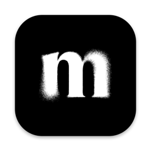
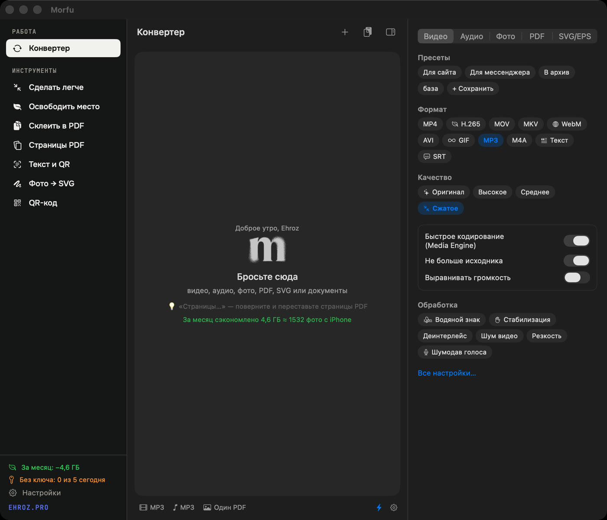
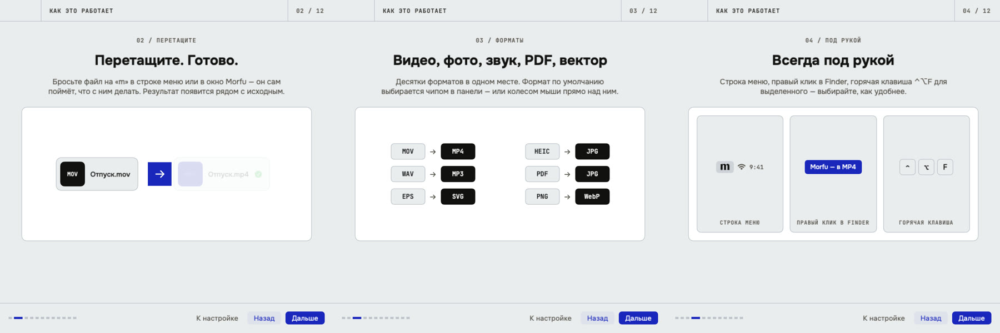
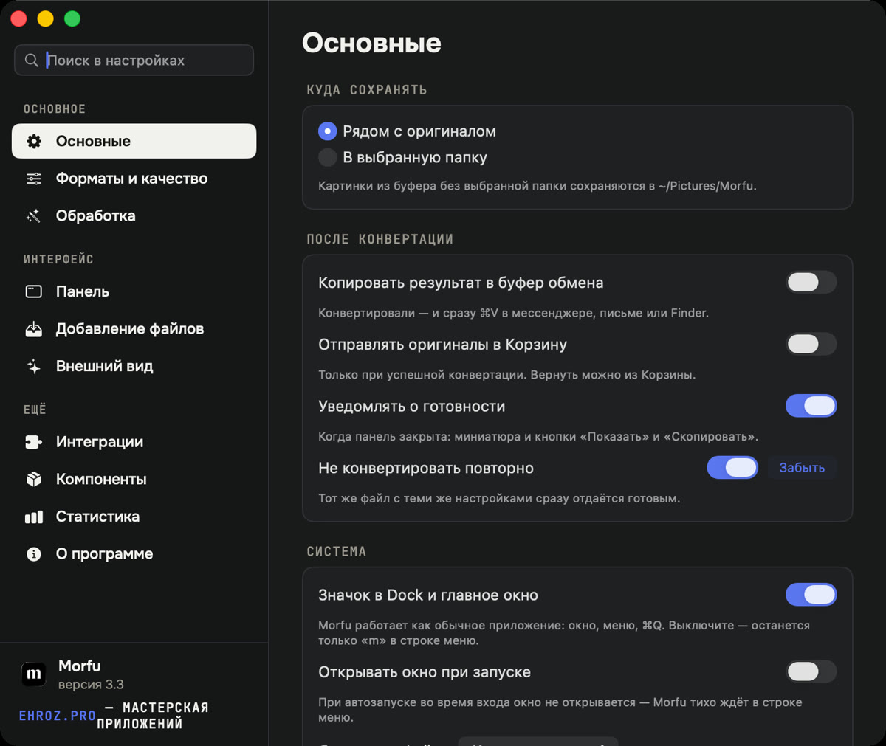
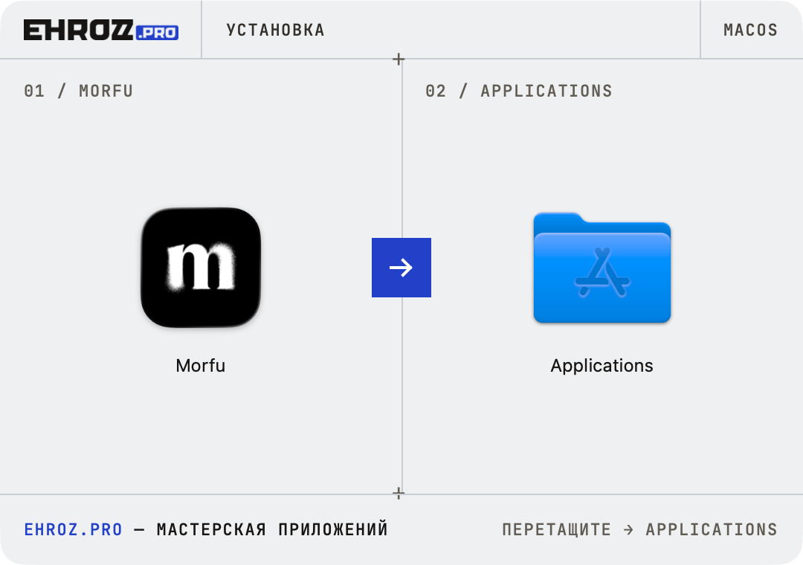

<h1 align="center">Morfu</h1>

Конвертер файлов в строке меню macOS. Бросьте файл на «m» — заберите готовый.

<a href="https://github.com/ehroz1/morfu-releases/releases/latest/download/Morfu.dmg"><b>⬇︎ Скачать Morfu для Mac</b></a> · <a href="https://github.com/ehroz1/morfu-releases/releases/latest">все файлы релиза</a> · <a href="https://ehroz.pro">ehroz.pro</a>

## Что умеет

**Видео** — MP4 (H.264 / H.265), MOV, MKV, WebM, AVI, GIF, звук в MP3 / M4A / WAV. Кодирование на Media Engine Apple Silicon — быстро и тихо.
**Фото** — JPG, PNG, HEIC, WebP, AVIF, TIFF; «тот же формат, но легче»; несколько фото → один PDF.
**PDF** — сжатие (текст остаётся текстом), в JPG / PNG / SVG постранично, склейка, страницы.
**Вектор** — SVG в PNG / PDF, EPS и Illustrator в SVG / PDF / PNG, растр → SVG.
**Документы** — DOCX, RTF, ODT, HTML, Markdown → PDF. **Речь** — расшифровка в текст и субтитры, без интернета.

Всё работает **на вашем Mac**: файлы никуда не загружаются.

## Всегда под рукой

- Перетащите файлы на «m» в строке меню или в окно Morfu.
- Правый клик в Finder → «Morfu — в MP4 / в JPG / сжать PDF / EPS в SVG…».
- <kbd>⌃⌥F</kbd> — конвертировать выделенное в Finder, <kbd>⌃⌥C</kbd> — сжать то, что в буфере.
- Ссылки для скриптов и Быстрых команд: `morfu://convert?format=mp4&path=/путь/к/файлу`.

При первом запуске Morfu показывает короткую презентацию и задаёт пять вопросов, чтобы в панели осталось только нужное. Всё можно поменять в настройках.

## Установка

1. Скачайте [**Morfu.dmg**](https://github.com/ehroz1/morfu-releases/releases/latest/download/Morfu.dmg) и откройте его.
2. Перетащите Morfu в «Программы» — или откройте Morfu прямо из окна и нажмите синюю стрелку: он сам встанет на место.
3. Первый запуск: macOS скажет, что не может проверить разработчика. Нажмите «Готово», затем «Системные настройки → Конфиденциальность и безопасность → **Всё равно открыть**». Это один раз.
   Если кнопки нет — в Терминале: `xattr -dr com.apple.quarantine /Applications/Morfu.app`.

macOS 13 и новее, Apple Silicon и Intel. Для видео и звука Morfu сам предложит поставить ffmpeg — без Терминала.

## Обновления и настройки

Morfu **обновляется сам**: раз в 4 часа проверяет этот репозиторий, скачивает новую версию в фоне и ставит её при выходе. Выключается в «Настройки → О программе».

Копия настроек и ключа хранится в `~/.morfu` — после удаления и новой установки Morfu восстановит всё сам. Для другого Mac: «Настройки → О программе → Перенос настроек».

## Цена

14 дней доступно всё. Потом без ключа — до 5 файлов в день. **Ключ покупается один раз**: обновления и поддержка — бессрочно.
Купить ключ: Telegram [@hhrrzz1](https://t.me/hhrrzz1) · WhatsApp @ehroz.

---

Morfu сделан в <a href="https://ehroz.pro"><b>ehroz.pro</b></a> — мастерской приложений. Здесь только готовые сборки и лента обновлений, исходный код закрыт.

